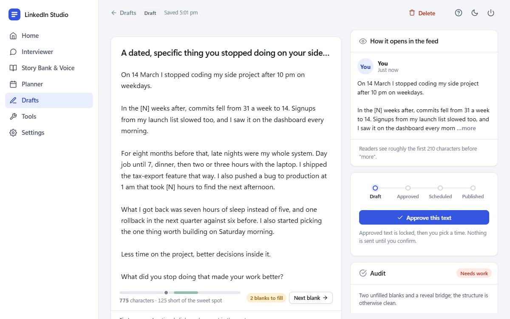
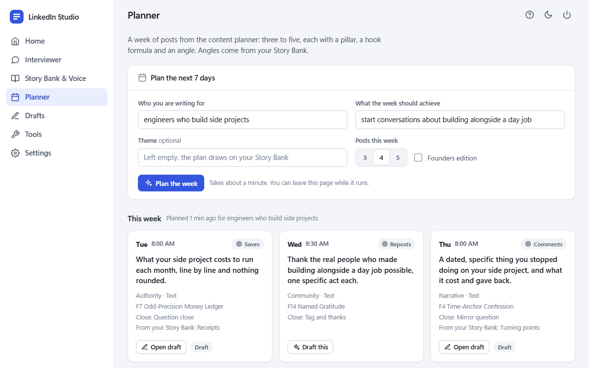
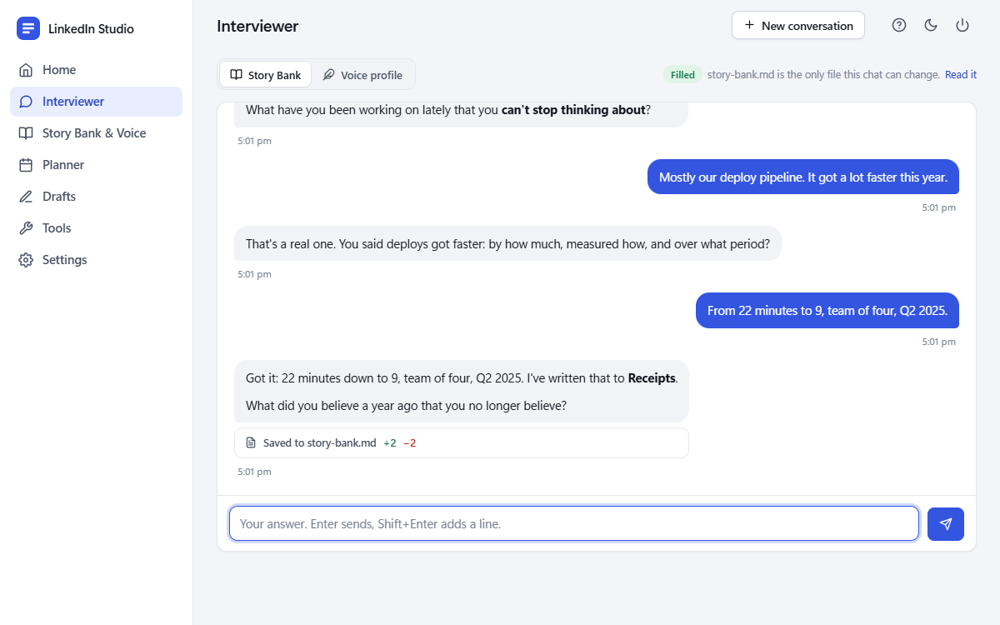
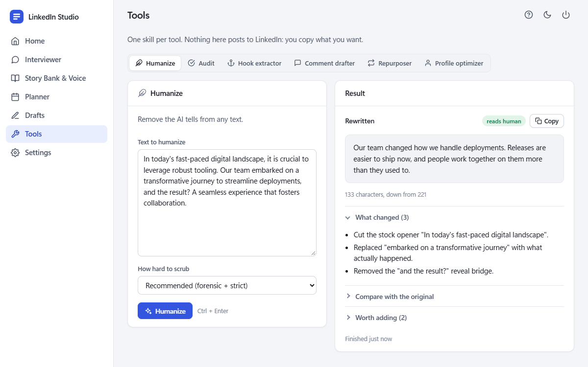
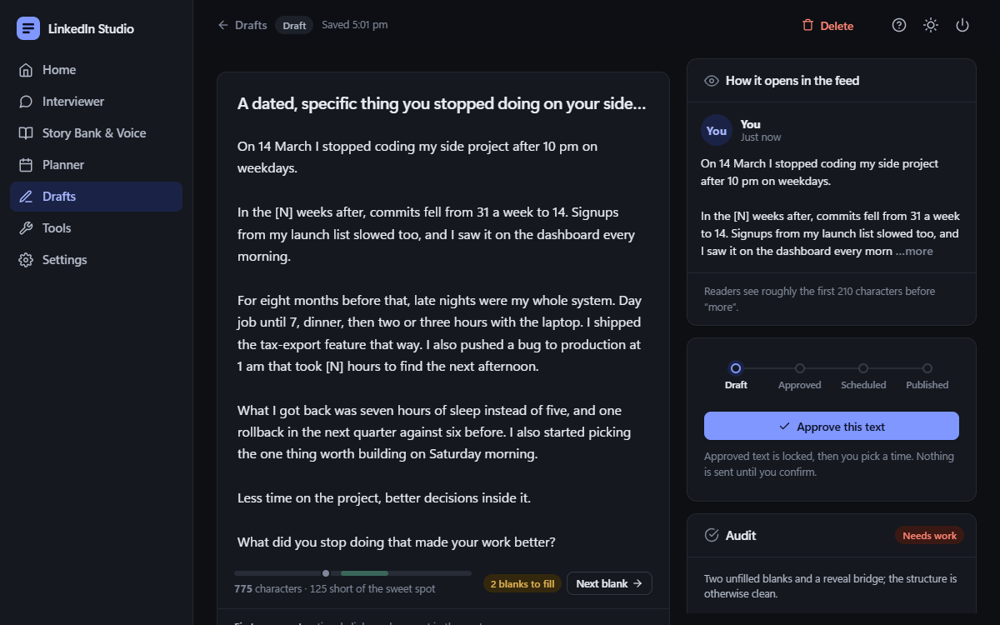
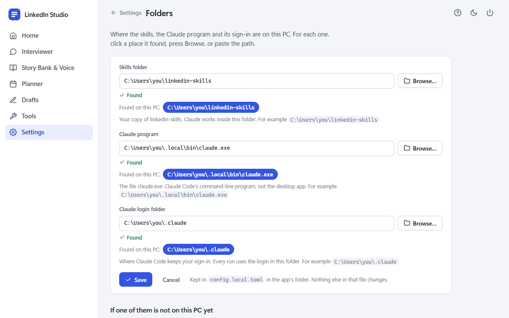

# LinkedIn Studio

A local, single-user Windows app that runs the
[linkedin-skills](https://github.com/sergebulaev/linkedin-skills) Claude Code skills from a UI.
You double-click a shortcut and an app window opens. Closing the window stops everything.

- **Claude:** the Claude Code CLI in headless mode (`claude -p`) on your own login. There is no
  API key and no cloud hosting.
- **Publishing:** goes through Publora (free tier: 15 posts a month), and only after you approve
  the text and confirm the time.
- **Comments and replies:** drafted for you to copy. The app never posts them.
- **Storage:** everything stays on this machine (`data\`, plus two files in the skills repo).

## Screens



**New to it? Press ? in the top bar.** The built-in Guide shows the routine as a flowchart you
can click or play through, runs a pretend job so you can see how progress works, gives you an
editor to practise in, and tours every screen with pictures.

| Screen | What it does |
|---|---|
| Guide (the **?** button) | The routine step by step, what each button does, the four post states, shortcuts and limits |
| Home | Setup checklist, posts used this month (x of 15), the next scheduled post, Claude's status and login folder, last health check, this week's plan, scheduled posts (IST) |
| Interviewer | Chat with `linkedin-interviewer` (fills the Story Bank) or `linkedin-humanizer --mode profile` (fills the voice profile). Enter sends. Each reply shows what it saved to the file |
| Story Bank & Voice | Both files, formatted and read-only, with a section list showing which sections have material |
| Planner | Audience + goal (+ theme, 3-5 posts) → a board of post cards → **Draft this** on any card. Comment targets and the inbound-readiness checklist sit below |
| Drafts | The list, **Write a post** (the post writer from a topic) and blank drafts |
| Draft editor | See below |
| Tools | Humanize, Audit, Hook extractor, Comment drafter, Repurposer, Profile optimizer. Input on the left, result on the right, copy buttons. A repurposed post can be saved as a draft |
| Settings | Claude and publishing status, **Change folders**, light/dark/auto theme, the two health checks, recent runs |

**The draft editor**

- **Autosave.** Text saves about a second after you stop typing (Ctrl+S saves at once). Approve,
  Audit and the Revise buttons save first, so they always act on what is on screen.
- **Character meter.** Shows where the post sits against the 900-1,300 sweet spot and LinkedIn's
  3,000 limit.
- **Feed preview.** Shows roughly what readers see before "more" (about 210 characters).
- **Blanks.** The writer marks facts it does not have as `[N]` or `[DD Month YYYY]`. The editor
  counts them, **Next blank** jumps to each one, and Approve refuses while any remain.
- **Audit.** Findings appear beside the text.
- **Revise.** New hook, Shorter or More technical shows the changes word by word. Nothing is
  replaced until you choose **Use this version**.
- **Publish.** Draft → Approved → Scheduled → Published. Approved text is locked. Scheduling asks
  for a time (with the skills' recommended slots one click away) and then confirms the final
  text, time and first comment.
- **Delete.** Drafts can be deleted. Scheduled and published posts cannot; cancel them on Publora
  first.

**Jobs**

- Claude runs one job at a time; others wait in line.
- A running job shows what it is doing, a timer and a Cancel button, and its result appears in
  place when it finishes.
- You can leave the page: the top bar shows the running job, and a notice with a link appears
  when it ends.









These are the Guide's own pictures, taken from the demo server by `dev\guide_shots.py`.

## First run

You need:

1. Windows 11 and Python 3.11 or newer (`py -3 --version`).
2. [Claude Code](https://code.claude.com/docs/en/setup), installed and signed in: run `claude`
   once in a terminal and log in. The app needs the real `claude.exe`. If yours came from npm,
   run `claude install` to get it.
3. A copy of the skills, cloned with real links. Turn on Developer Mode in Windows Settings
   first, then run:
   `git -c core.symlinks=true clone https://github.com/sergebulaev/linkedin-skills`
4. This repository, in any folder.

Then:

1. **Launch.** Double-click `Launch LinkedIn Studio.vbs`, or make a desktop shortcut with the
   snippet in [docs/SHORTCUT.md](docs/SHORTCUT.md). The first time, a console window builds
   `.venv` and installs the pinned packages (about a minute). After that there is no console.
2. **Set the three folders.** On a new PC the app opens its setup screen first. See below.
3. **Keys.** In your skills folder, copy `.env.example` to `.env` and set:
   - `PUBLORA_API_KEY=sk_…` (Publora → Settings → API)
   - `LINKEDIN_PLATFORM_ID=linkedin-…` (Publora → Channels → your LinkedIn account)
   - optional: `APIFY_TOKEN=apify_api_…`, so post URLs can be fetched instead of pasted
   - **Delete the lines you don't use.** The placeholders from `.env.example` are ignored by this
     app but count as "set" for the skills' own scripts.

### Setting the three folders

The app has to know where three things are on your PC. On a new PC it opens a setup screen
for this before anything else. Later the same screen is under **Settings → Change folders**.

| Folder | What it is | Usually |
|---|---|---|
| Skills folder | Your clone of linkedin-skills. Claude works inside it | next to this folder, or `C:\Users\you\linkedin-skills` |
| Claude program | `claude.exe`, the Claude Code command-line program (not the desktop app) | `C:\Users\you\.local\bin\claude.exe` |
| Claude login folder | Where Claude Code keeps your sign-in | `C:\Users\you\.claude` |



For each one you can:

- click a place the app **found on this PC** (it looks in the usual locations),
- press **Browse…** and choose it in a Windows file window, or
- paste the path. A path copied with Explorer's "Copy as path" works, quotes included.

An example path is shown under every box. **Save** checks all three, writes them to
`config.local.toml` and restarts the app. As part of the check it asks the program for its
version, so a different `claude.exe` is caught there and not on your first job.

By hand instead: copy `config.example.toml` to `config.local.toml` and set `skills_dir`,
`claude_bin` and `claude_config_dir`. The other settings in that file (port, time zone, model,
limits) are only changed there.

If you keep a separate Claude login for this app, point **Claude login folder** at it. Every
run uses exactly the login in that folder, whatever terminal or editor started the app.

## How it stays safe

- **Claude's account.** Each Claude run gets `CLAUDE_CONFIG_DIR` from the config, never from the
  environment, so the app always uses the login you chose, whatever terminal or editor started
  it. If the folder is missing, the app refuses to run Claude. `ANTHROPIC_API_KEY` is stripped,
  so a run can't fall back to paid API billing.
- **What Claude can do.** The backend picks the tools for each skill:
  - Stateless skills get `Skill` and `Read` only. Reads work inside `linkedin-skills` only;
    `.env` and anything outside are denied.
  - The Interviewer and voice-profile modes may also edit their one file: `story-bank.md` or
    `voice-profile.md`.
  - No skill gets Bash, MCP servers or network tools.
  - Prompts go in on stdin; the command is a list, with no shell.
  - Apify fetching and Publora publishing are done by the app, not by Claude.
- **Limits.** 12 turns and 180 s per run. A timeout or Cancel kills the whole process tree
  (Windows Job Object).
- **Approving.** Approve refuses text that still contains placeholder slots like `[N]` or
  `[DD Month YYYY]`. The writer leaves these where it has no real fact.
- **Scheduling happens exactly once:**
  - Scheduling is one database transaction from approved to scheduling, so double-clicks can't
    send twice.
  - It is a single Publora request carrying an `Idempotency-Key`.
  - After a failed or timed-out call, Retry resends the identical request with the same key,
    which Publora replays instead of re-posting.
  - Times must be between 2 minutes and 14 days ahead.
  - The monthly limit is checked on the server. It counts scheduling, scheduled and published
    posts in the IST calendar month; Publora keeps its own count too.
- **The web server.** It listens on `127.0.0.1` only, with a random token per launch. The token
  becomes an HttpOnly, SameSite=Strict cookie, and any request that changes something must come
  from `http://127.0.0.1:<port>`. Other websites open in your browser can't use it.

## Your Story Bank stays out of git

The Story Bank and the voice profile hold career detail, real numbers and named people. Both
are files the skills repository tracks as empty templates, so a filled copy would travel with
any commit and push of that folder. A `.gitignore` line does not help for a file git already
tracks, so the app does this instead, every time it starts:

- It sets git's skip-worktree flag on both files in your clone. Git then treats your filled
  copies as unchanged: they never show in `git status`, `git add -A` skips them, and they cannot
  reach a commit or a push.
- It covers the two copies the skills' self-test writes under `.codex-marketplace\` as well.
- It lists all four paths in the clone's private ignore file (`.git\info\exclude`).

Nothing in the skills repository is edited; the flag lives in your clone only. The Story Bank
page shows the result (**Private: kept out of git**) and Settings repeats it. The interviewer
is told the same, so it no longer asks you to edit `.gitignore` yourself.

If the skills folder is not its own repository, the app changes nothing. It says so when the
folder sits inside another repository that does not ignore these files.

This repository has its own guard: `.gitignore` refuses `.env` files, databases and any
`story-bank*.md` or `voice-profile*.md`, so a backup copied in here cannot be committed, and a
test fails if a tracked file ever looks like one of those or like a real Publora key.

## Where data lives

| What | Where |
|---|---|
| Plans, drafts, posts, chat history, job log | `data\studio.db` (SQLite) |
| Launcher log | `data\studio.log` |
| The app window's browser profile | `data\browser-profile\` |
| Story Bank | `linkedin-skills\references\story-bank.md` |
| Voice profile | `linkedin-skills\references\voice-profile.md` |
| API keys | `linkedin-skills\.env` (never shown by the app) |

`data\` and `config.local.toml` are gitignored here. The Story Bank and voice profile are kept
out of git in the skills clone by the app (see above).

## Backups

Close the app first, so SQLite isn't mid-write. Then:

```powershell
$studio = "C:\path\to\linkedin-studio"    # this folder
$skills = "C:\path\to\linkedin-skills"    # your skills folder
$dest = "$env:USERPROFILE\Documents\linkedin-studio-backup\$(Get-Date -Format yyyy-MM-dd)"
New-Item -ItemType Directory -Force $dest | Out-Null
Copy-Item $studio\data\studio.db $dest
Copy-Item $skills\references\story-bank.md, $skills\references\voice-profile.md $dest
```

To restore, copy the files back with the app closed.

## Updating the skills

```powershell
git -C C:\path\to\linkedin-skills pull
```

That is all it takes while upstream leaves the two templates alone: your filled Story Bank and
voice profile stay as they are.

If upstream changed a template too, the pull refuses ("your local changes would be
overwritten"), and `git stash` cannot help because git does not look at these files. Close the
app, then:

```powershell
cd C:\path\to\linkedin-skills
$files = "references/story-bank.md", "references/voice-profile.md",
         ".codex-marketplace/linkedin-skills/references/story-bank.md",
         ".codex-marketplace/linkedin-skills/references/voice-profile.md"
$keep = "$env:USERPROFILE\Documents\linkedin-studio-backup\before-pull"
New-Item -ItemType Directory -Force $keep | Out-Null
Copy-Item references\story-bank.md, references\voice-profile.md $keep    # your filled copies
git update-index --no-skip-worktree -- $files                             # let git see the files again
git checkout -- $files                                                    # back to the templates
git pull
Copy-Item $keep\story-bank.md, $keep\voice-profile.md references\        # put your copies back
```

Then open LinkedIn Studio before you do anything else with git: it protects the files again as
it starts. Afterwards, run **Settings → Connections** and one Tools run to confirm the skills
still load.

## Troubleshooting

| Symptom | Fix |
|---|---|
| The setup screen opens instead of the app | One of the three folders is missing or wrong, for example after a folder was moved. Choose it again on that screen. |
| **Browse…** seems to do nothing | The Windows file window opened behind another window. Look for it on the taskbar, or paste the path instead. |
| Jobs fail with "Please run /login" or "Invalid API key" | The login in the Claude login folder has expired. In PowerShell run `claude`, type `/login`, sign in, then `/exit`, and retry the job. If the app uses a login folder other than the default, name it first: `$env:CLAUDE_CONFIG_DIR = "C:\Users\you\.claude-other"`. |
| "Claude did not find the skill …", or the setup screen says the skills are not real links | `linkedin-skills\.claude\skills\*` were checked out as text files. With Developer Mode on, re-clone: `git -c core.symlinks=true clone https://github.com/sergebulaev/linkedin-skills`. Check with `Get-ChildItem linkedin-skills\.claude\skills`: LinkType must be `SymbolicLink`. |
| Error page: port in use | Another program has the port. Set another `port` in `config.local.toml`. If it is an old LinkedIn Studio, close its window or end `pythonw.exe` in Task Manager. |
| Publora 401 | Wrong or revoked `PUBLORA_API_KEY`. Create a new key in Publora → Settings → API. |
| Publora 400 (`Invalid platform ID`, missing platformId) | `LINKEDIN_PLATFORM_ID` is wrong: copy the whole `linkedin-…` id from Publora → Channels. `SCHEDULED_TIME_IN_PAST`: pick a later time. |
| Publora 404 | Wrong platform id, or the post was already deleted on Publora. |
| Publora 403 `POST_LIMIT_REACHED` | Publora's own monthly limit. It can differ from the app's count, which only sees posts scheduled from here. |
| "No answer from Publora … may or may not have created the post" | Check the Publora dashboard, then use **Retry**. It reuses the same idempotency key, so it can't create a second copy (within 24 h). |
| Error page: browser not found | Set `browser_path` in `config.local.toml` to `chrome.exe` or `msedge.exe`. |
| A job says "Claude answered, but not in the shape the app reads" | Claude answered without the result block. Its full reply is shown; press **Try again**. |
| Approve says there are placeholder slots | Use **Next blank** to fill in every `[…]` with a real detail (or delete the sentence), then approve. |
| A job timed out | Raise `timeout_seconds` in `config.local.toml` and restart the app. |
| "This window belongs to an earlier session" | The app was restarted while this window stayed open. Close it and open LinkedIn Studio from the shortcut. |
| The Story Bank page says **Not protected from git** | Git is missing or refused. Install Git for Windows and restart the app. If the skills folder sits inside another repository of yours, add the two files to that repository's `.gitignore`. Until it says Private, do not commit or push that folder. |
| Pages look broken or show errors right after the app's code changed | The running app still has the old code. Close its window (that stops it) and open it again. |

## Development

```powershell
cd C:\path\to\linkedin-studio
.venv\Scripts\python -m pip install -r requirements-dev.txt
.venv\Scripts\python -m pytest            # runner, kill-tree, parsing, scheduling, quota, security, UI routes
.venv\Scripts\python -m app               # dev server; prints the sign-in URL
.venv\Scripts\python dev\demo_server.py   # the UI with scripted jobs: no Claude, no Publora, a copy of your data
```

The demo server is the way to work on the UI: every job finishes in a few seconds with canned
output, so each screen and each in-between state can be looked at without spending anything.
The front end is `app\templates\` (Jinja), `app\static\app.css` (design tokens at the top, light
and dark) and `app\static\app.js`, on top of a vendored htmx. No build step.

The Guide's words live in `app\guide.py` and its pictures in `app\static\guide\`. After a change
to the UI, retake the pictures: start `dev\demo_server.py --empty`, then run
`dev\guide_shots.py` (it needs Playwright; the file's first lines say how). It fills the demo
through the UI and photographs every screen in light and dark.

`docs/skill-inventory.md` covers what each skill takes and produces, the Publora client surface,
and the gaps found when this was built.

One test uses the real skills code and is skipped unless a linkedin-skills clone sits next to
this folder.

## Licence

MIT. See [LICENSE](LICENSE). The licences of the two projects this app includes are in
[THIRD_PARTY_NOTICES.md](THIRD_PARTY_NOTICES.md).
